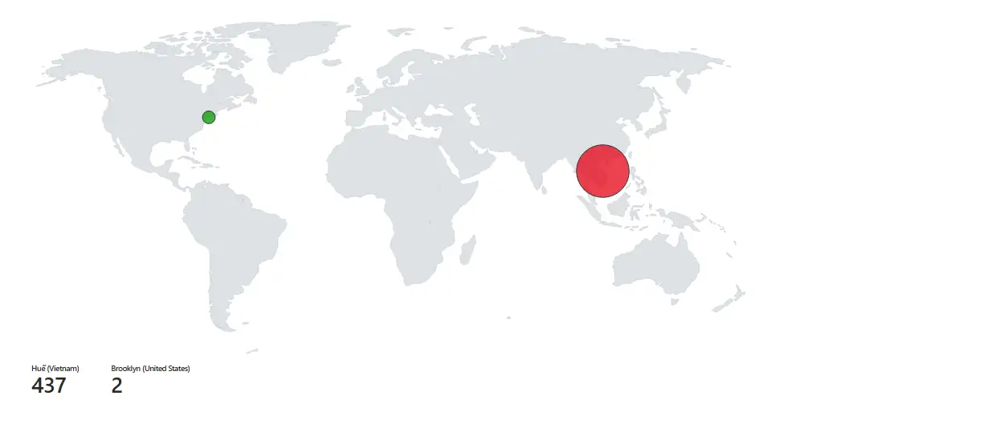
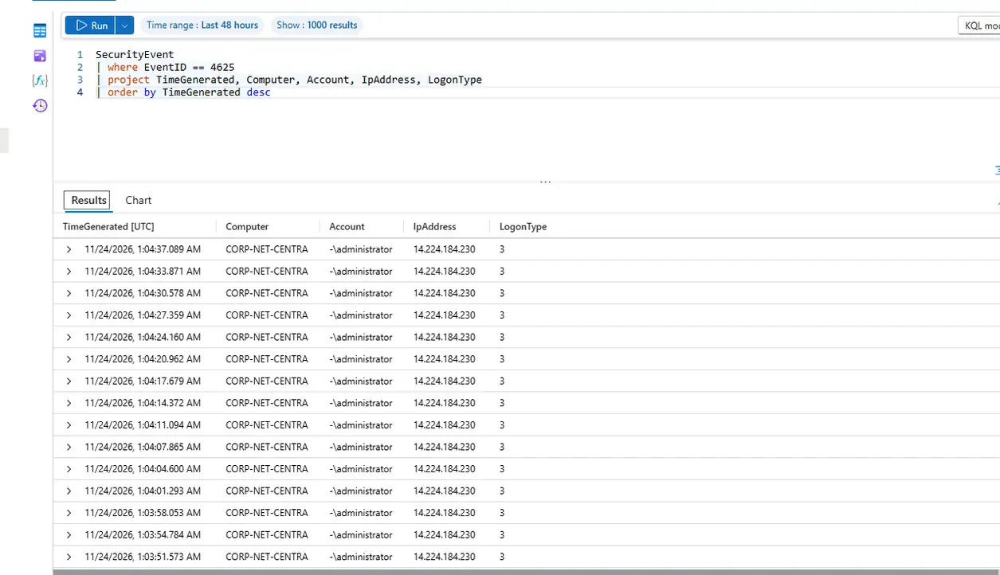
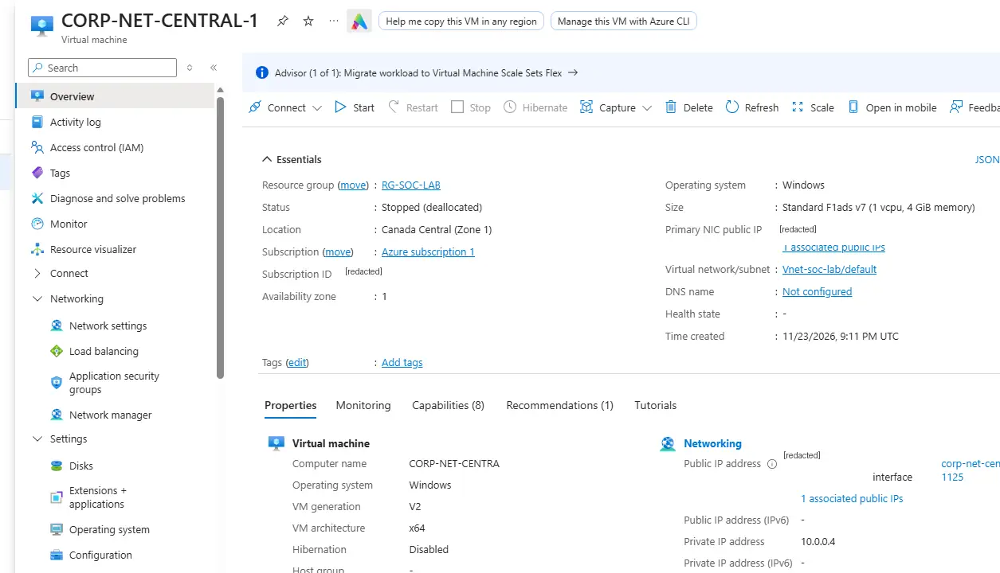

# Azure Sentinel Threat Map
**Windows Authentication Monitoring · Microsoft Sentinel · Azure Log Analytics · KQL**

**Navin Jeganathan** · Computer Science (Co-op), University of Guelph

A hands-on cloud security lab built to collect Windows authentication telemetry, investigate failed sign-ins, and visualize source-IP geolocations using Microsoft Azure and an Azure Workbook.

*Figure 1 — My actual Azure Workbook map captured on November 24, 2026. Cropped to remove the Azure account sidebar.*

> **Investigation note:** Recorded failures are security events, not confirmed successful attacks. IP geolocation cannot establish an individual's true physical location.

## Project overview

| | |
|:--|:--|
| **Environment** | Azure Windows 11 Pro VM, Canada Central (Zone 1), resource group RG-SOC-LAB |
| **Workspace** | Azure Log Analytics: LAW-soc-lab |
| **Log source** | Windows SecurityEvent table |
| **Event investigated** | Event ID 4625 — failed Windows logon |
| **Analysis** | Kusto Query Language (KQL), geoip watchlist, ipv4_lookup |
| **Visualization** | Azure Workbook geographic map |
| **Lab status** | VM verified Stopped (deallocated) following the experiment |

## Objective

I built this lab to learn how cloud monitoring tools turn individual Windows security events into data that can be investigated and visualized. The goal was to trace failed sign-ins from a Windows virtual machine into a centralized log workspace, enrich source IP addresses with geographic context, and document the resulting patterns and their limitations.

## Architecture

~~~mermaid
flowchart LR
    VM["Azure Windows VM Failed logon events"] --> LA["Log Analytics SecurityEvent table"]
    LA --> KQL["KQL Event ID 4625"]
    GEO["Sentinel geoip watchlist"] --> LOOKUP["ipv4_lookup"]
    KQL --> LOOKUP
    LOOKUP --> MAP["Azure Workbook Geographic event map"]
~~~

*Geographic markers represent approximate IP-location data, not validated attacker locations.*

## Implementation

1. **Created an Azure Windows environment.** Provisioned a Windows 11 Pro VM in the Canada Central region with a virtual network and RDP for lab access.
2. **Collected authentication telemetry.** Used Log Analytics to examine Windows SecurityEvent records generated by the VM.
3. **Filtered failed logons.** Queried Event ID 4625 and selected event time, computer, account, IP address, and logon type for inspection.
4. **Added IP enrichment.** Applied the Sentinel watchlist named geoip through the ipv4_lookup function to associate IPs with latitude, longitude, city, and country data.
5. **Created a map workbook.** Aggregated matching records into FailureCount, then visualized marker size, location labels, and green-to-red colors in Azure Workbooks.
6. **Reviewed and secured the lab lifecycle.** Captured findings and verified that the Windows VM later displayed Stopped (deallocated).

## Verified source files

These files contain the **actual queries and workbook item settings** shared from my Azure environment, not reconstructed examples.

- [Geographic enrichment and workbook KQL](queries/threat-map.kql) — filters Event ID 4625, joins with the geoip watchlist, and groups events by source IP/location.
- [Event ID 4625 investigation query](queries/failed-logons-4625.kql) — selects TimeGenerated, Computer, Account, IpAddress, and LogonType.
- [Azure Workbook map configuration](workbook/windows-vm-attack-map-item.json) — saved map item including 24-hour time context, coordinates, labels, event counts, and heatmap settings.

The original workbook field name **AttackerIp** is retained in the KQL for accuracy; it is a column alias and does not establish that the address belongs to a confirmed attacker.

## Findings and validation

### Workbook geographic results

My captured Azure Workbook map displayed these record counts:

*The map displays the actual plotted geolocations and record counts from my lab.*

| Approximate city/country | Records displayed |
|:--|--:|
| Huế, Vietnam | **437** |
| Brooklyn, United States | **2** |
| **Total map records** | **439** |

The exported workbook item specifies a **24-hour** query time context. The counts represent grouped authentication events, not 439 unique IP addresses or proven intrusions.

### Windows event inspection

In Log Analytics, I also ran this query with the portal set to **Last 48 hours**:

~~~kusto
SecurityEvent
| where EventID == 4625
| project TimeGenerated, Computer, Account, IpAddress, LogonType
| order by TimeGenerated desc
~~~

The captured query results displayed **439 rows**. Visible rows showed failed logon attempts involving an administrator account and **LogonType 3**, which identifies a network logon. This corroborates that relevant event data was present in the workspace.

*Figure 2 — My Event ID 4625 query and sample results with the portal set to Last 48 hours.*

**Important limitation:** The 48-hour event query and the 24-hour map workbook have different time selectors, so they should not be assumed to describe precisely the same set of events merely because both displayed 439 records.

### Interpretation

Repeated authentication failures associated with an administrative account are worth investigating. However, event 4625 by itself does not demonstrate a successful login, prove RDP compromise, or confirm a distinct attack for each event. A fuller investigation would inspect the unique source IPs, failure reasons, event rate, and related successful-logon events.

### Environment evidence

My captured VM overview showed CORP-NET-CENTRAL-1, Windows, Canada Central (Zone 1), and **Stopped (deallocated)**. The screenshot below has its subscription ID and VM public IP removed for public sharing.

*Figure 3 — Lab VM in Canada Central after deallocation.*

## Skills demonstrated

- Deploying and managing an Azure-hosted Windows virtual machine for an educational security lab
- Investigating failed Windows sign-ins with Event ID 4625 and network logon type
- Running KQL queries and interpreting the SecurityEvent table in Azure Log Analytics
- Enriching event IPs with a Sentinel GeoIP watchlist
- Visualizing aggregated security data in an Azure Workbook
- Presenting findings with appropriate limitations and reproducible technical details

## Safety, costs, and scope

This was a **controlled educational lab**, not a production monitoring system. An internet-accessible RDP endpoint should never be left open solely to generate authentication attempts. Stopping and deallocating the VM pauses compute charges, but disks, public IP resources, and logging services may still incur costs. Sensitive subscription identifiers, credentials, and live VM public IP details are excluded from published content.

## Further investigation

- Group failures by source IP and time bucket to evaluate the rate and variety of attempts.
- Compare Event ID 4625 against relevant Event ID 4624 records when assessing whether any sign-ins succeeded.
- Document the geographic enrichment dataset and track limitations of location attribution.

## Acknowledgment

Based on Josh Madakor's [Cyber Home Lab from ZERO and Catch Attackers](https://www.youtube.com/watch?v=g5JL2RIbThM) tutorial. The queries, workbook settings, and numerical findings documented here came from my own lab. This portfolio project reflects technical training, not professional SOC employment.
