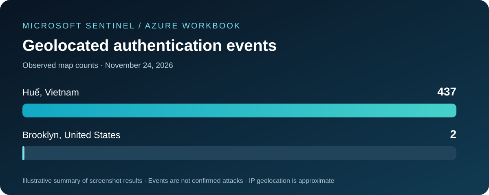
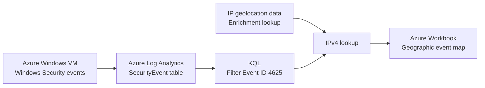

# Azure Sentinel Threat Map

**Windows authentication monitoring | Microsoft Sentinel · Azure Log Analytics · KQL · IP geolocation**  
Navin Jeganathan · Computer Science Co-op · University of Guelph

A hands-on security operations lab that collects Windows authentication events from a cloud-hosted virtual machine, investigates failed sign-ins, and visualizes the geographic distribution of source IP addresses through an Azure workbook.

*Figure 1 — Visual summary of the event counts shown in my Azure Workbook on November 24, 2026. This graphic is a reconstruction of the observed counts, not an exported workbook screenshot.*

> **Scope:** Personal, controlled training environment. The map represents observed log events—not confirmed intrusions or verified attacker locations.

## Project overview

| | |
|---|---|
| **Focus** | Security monitoring, log analysis, and geographic enrichment |
| **Environment** | Windows 11 Pro VM in Azure Canada Central (`CORP-NET-CENTRAL-1`) |
| **Telemetry** | Windows Security events in the Log Analytics `SecurityEvent` table |
| **Investigated event** | Windows Security Event ID `4625` — failed logon |
| **Analysis & visualization** | Kusto Query Language (KQL), IP geolocation enrichment, Azure Workbook / Microsoft Sentinel |
| **Lab resource group** | `RG-SOC-LAB` |

### Objective

I built this lab to understand how a security operations team can turn raw Windows authentication logs into information that is easier to investigate. Rather than looking only at individual Event Viewer entries, I wanted to trace failed sign-ins through a centralized log platform and visualize patterns across reported IP geolocations.

## Architecture

*The map uses source-IP geolocation metadata to position events. A plotted point does not establish the physical location or identity of an attacker.*

## Implementation

1. **Deployed the lab VM.** Created an Azure resource group and Windows VM in the Canada Central region. Used RDP to access and test the Windows environment.
2. **Collected Windows authentication telemetry.** Used Azure Log Analytics to inspect events in the `SecurityEvent` table and focus the investigation on Event ID `4625` (failed logons).
3. **Mapped source IPs to geographic locations.** Configured the lab workbook to associate failed-logon source IPs with approximate city/country and coordinates. The exact enrichment implementation should be confirmed against the exported workbook query.
4. **Built the map visualization.** Queried and grouped the records by source IP and geographic fields, then displayed the resulting counts using an Azure Workbook map.
5. **Reviewed results and managed the environment.** Inspected the geographic concentrations in the map and initiated VM deallocation when active collection was no longer needed.

**Query example:** [queries/threat-map.kql](queries/threat-map.kql) is an **illustrative reconstruction**, not a confirmed export of the exact query executed in my workbook. It shows the likely `SecurityEvent` / `geoip` lookup workflow and must be checked and replaced with my original workbook KQL before I present it as reproducible. It requires a matching watchlist schema and Log Analytics data.

## Findings and validation

The following values appeared in my workbook's map in a screenshot from **November 24, 2026**:

| Geolocated city | Events displayed | Interpretation |
|---|---:|---|
| Huế, Vietnam | **437** | Concentration of failed-sign-in records associated with geolocation data for source IPs |
| Brooklyn, United States | **2** | Smaller number of mapped failed-sign-in records |

**What the results show:** The workbook successfully produced a geographic visualization from Windows security data and IP enrichment. The large difference in record counts gives an analyst a starting point for reviewing source IPs, timestamps, logon types, and failure reasons.

**What they do not show:** The map alone does **not** prove 439 distinct cyberattacks, successful account compromise, or that the people responsible were physically in those cities. Counts reflect the workbook query and its selected time window; IP geolocation can be inaccurate or reflect proxies and VPNs.

### Evidence: Azure VM configuration

The Azure VM overview showed the `CORP-NET-CENTRAL-1` Windows 11 Pro VM in `RG-SOC-LAB` (Canada Central, Zone 1). The captured VM screenshot showed that deallocation was in progress; subscription identifiers and the public IP were redacted in the local evidence copy. **The original screenshot is not included in this published version.**

### Evidence: Geographic visualization

The visualization above summarizes the counts observed in my actual Azure Workbook screenshot. My screenshot showed two approximate IP-geolocation locations and event counts; it was not uploaded with this initial public repository release.

## Skills demonstrated

- Working with cloud-hosted Windows systems and security telemetry
- Investigating Windows authentication failures using Event ID `4625`
- Exploring Windows security telemetry and KQL-based analysis in Log Analytics
- Visualizing security events by approximate source-IP location
- Building a data visualization that supports an initial security investigation
- Documenting security findings with appropriate limits on attribution

## Security, cost, and cleanup

This was a learning environment, **not a production monitoring deployment**. Internet-facing RDP is high risk and should not be left exposed just to attract sign-in attempts. Once sufficient evidence has been gathered, inbound access should be restricted or removed and the VM stopped/**deallocated**. Deallocation stops VM compute charges, but disks, public IP resources, workspaces, and other services may continue to incur charges. The full resource group should be removed after exporting all evidence that needs to be retained.

No authentication secrets, subscription identifiers, or live public IP addresses are intentionally included in this repository.

## What I'd improve next

- Add a time-bounded analysis query showing top source IPs and failure rates.
- Export the exact workbook KQL and record its selected time window to make the visualization reproducible.
- Explore additional context such as logon type, failure reason, and repeated attempts over time before assessing likely malicious activity.

## Acknowledgment

This lab was based on Josh Madakor's [Cyber Home Lab from ZERO and Catch Attackers](https://www.youtube.com/watch?v=g5JL2RIbThM) tutorial. The reported event counts were observed in my own Azure Workbook; the figure above is a reconstructed summary rather than the original screenshot. This is an educational demonstration of SIEM concepts, not professional SOC employment experience.